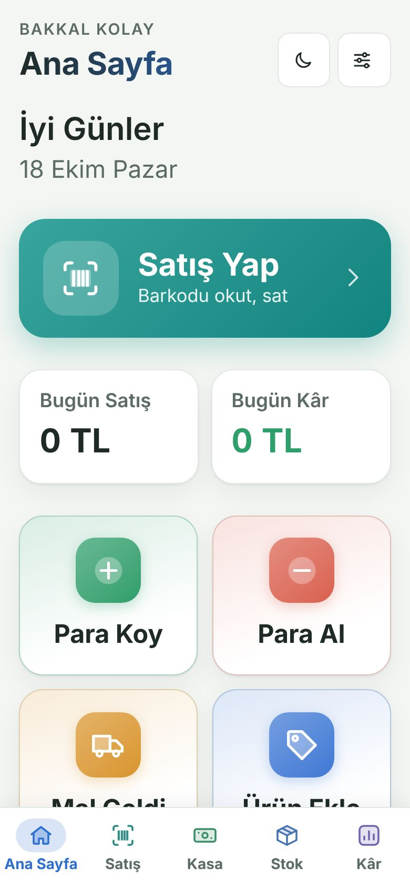
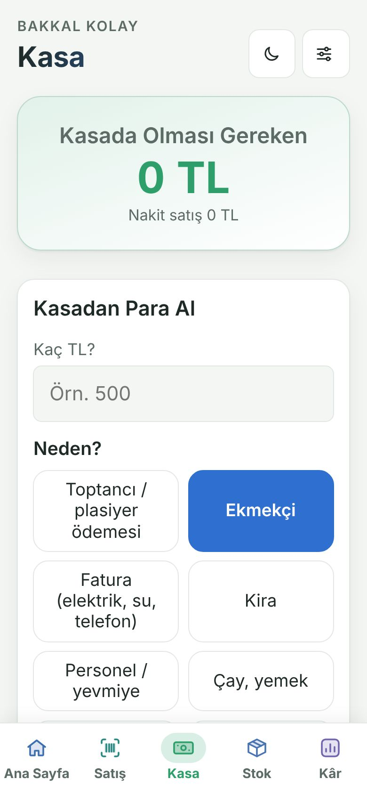
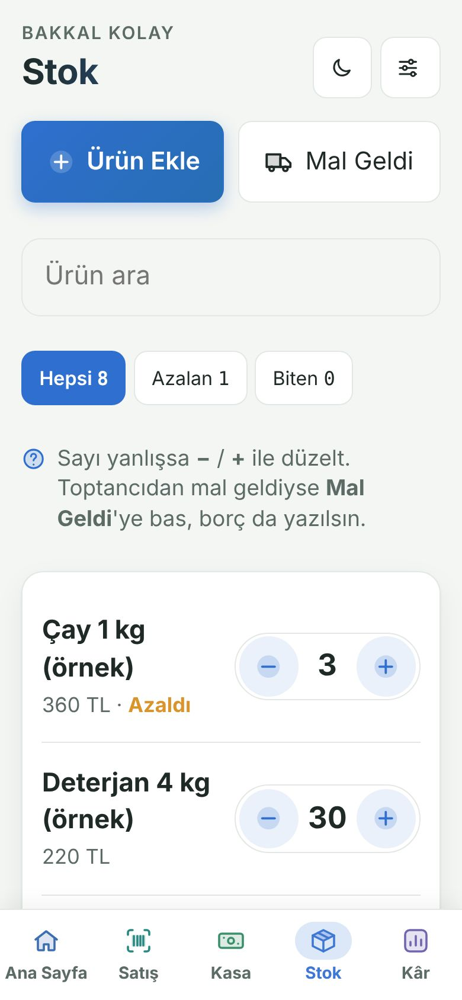
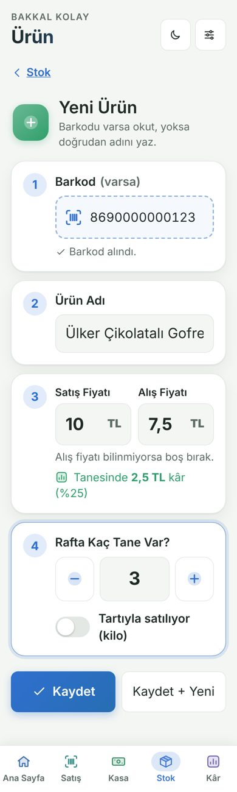

# Bakkal Kolay

**Aç:** https://joeamca.github.io/Bakkal-Kolay/

Bakkal Defteri'nin sade hâli: büyük düğmeler, az bölüm, kolay kullanım. Teknolojiyle arası iyi olmayanlar için yapıldı.

**Ayrı uygulama, aynı veri.** Bakkal Kolay, [Bakkal Defteri](https://github.com/joeamca/Bakkal)'nden bağımsız bir uygulamadır: kendi adresi, kendi dosyaları, kendi bildirimleri vardır. İkisi aynı Supabase hesabını ve dükkân kayıtlarını kullanır; Kolay'da yapılan satış tam sürümde görünür, tam sürümde eklenen ürün Kolay'da görünür. Kolay'dan tam sürüme geçiş düğmesi yoktur, ikisi ayrı ayrı telefona kurulur.

## Bölümler

Alt menüde sadece 5 bölüm var:

| Bölüm | Ne yapılır |
|---|---|
| **Ana Sayfa** | Kocaman "Satış Yap" düğmesi; bugünkü satış ve kâr; Para Koy, Para Al, Mal Geldi, Ürün Ekle kutuları; biten ürünler ve ödeme zamanı (varsa) |
| **Satış** | Barkodu okut, sepete eklensin; nakit, kart ya da veresiye |
| **Kasa** | Kasada olması gereken para; Para Koy, Para Al, Günü Kapat; sebep tek dokunuşla seçilir, toptancı ya da ekmekçi seçilince "Kime ödedin?" sorulur |
| **Stok** | Her ürünün yanında − / + ile raftaki sayı; Ürün Ekle ve Mal Geldi; ürüne dokununca düzenleme |
| **Kâr** | Satış − malın maliyeti − giderler = net kâr; bugün, bu hafta, bu ay, bu yıl; Excel'e indirme |
| **Excel yedek / geri yükleme** | Ürünler (barkodlar, kiloyla satış, hızlı düğme, terazi kodu, satış fiyatı tarihi), hareketler, veresiye müşterileri ve kayıtları, tedarikçi hesabı, **Satışlar** ve **Kasa** sayfaları Excel'e iner; aynı dosya geri yüklenince kayıtlar eksiksiz döner, tekrar yüklemek kayıtları ikiye katlamaz |

Ana Sayfa'nın altındaki **Diğer İşler** (ya da sağ üstteki ayar düğmesi): satış raporları, veresiye, tedarikçiler, bildirimler ve ayarlar.

Kolay sürüm yaşlılar ve teknolojiyle arası iyi olmayanlar düşünülerek sade tutuldu: büyük yazı, büyük düğmeler, her ekranda az iş.

## Ürün eklemek

Tek bir **Ürün Ekle** düğmesi var; barkodlu ya da barkodsuz fark etmez. Form 4 adım:

1. **Barkod:** Varsa okut, yoksa geç. Barkod başka üründe kayıtlıysa hemen uyarır, "Onu Düzenle" der.
2. **Ürün adı**
3. **Satış ve alış fiyatı:** Tanesinden kaç TL ve yüzde kaç kâr kaldığını anında gösterir; zararına satışta uyarır.
4. **Rafta kaç tane var:** − / + düğmeleriyle. Tartılı ürünler için tek dokunuşla "kilo" seçilir.

**Aynı isimde ürün varsa** yeni ürün açılmaz: "Ekmek zaten var, rafta 2 tane" der ve **Üstüne Ekle** ile geleni mevcut ürüne ekler (2 + 2 = 4). Eskiden iki kez eklenmiş ürünler Stok ekranının üstünde gösterilir; **Birleştir** ile stokları toplanıp tek ürün olur.

Çok ürün girerken **Kaydet + Yeni** ile kaydedip hemen sıradakini okutursun. Satışta tanınmayan bir barkod okutulursa aynı form açılır; kaydedince ürün doğrudan sepete eklenir.

## Tedarikçiler, mal geldi, sayım

- **Mal Geldi** (Ana Sayfa'da, Stok'ta ve ürün sayfasında): kimden aldın, kaç tane, kaça. Stok artar; borç yazılır ya da peşin ödenir (kasadan / kasa dışı).
- **− / +** (Stok'ta her ürünün yanında): raftaki sayıyı düzeltir. Kimseye borç yazılmaz; sayım gibidir.
- **Tedarikçiler** (Ana Sayfa'daki kısayol ya da ayar düğmesi): kime ne kadar borcun var, ne aldın, ne ödedin. Kasadan "Para Al" yaparken tedarikçi seçersen borcundan düşer. Vade dolunca Ana Sayfa'da "Ödeme Zamanı" çıkar ve bildirim gelir.

## Sesli komut (yapay zekâ)

Satış ekranında 🎤 düğmesi: "2 ekmek, 1 süt, Ahmet'e veresiye" gibi bir cümleyi söyle ya da yaz; ürünler **sepete** konur, müşteri seçilir. Yapay zekâ kendi başına satış kaydetmez: ödeme düğmesine sen basarsın. Yeni ürün ekranında da ad, fiyat, stok ve barkod rakamlarını söyleyerek kutular doldurulur; Kaydet'e sen basarsın. Barkod rakamları kontrol basamağıyla doğrulanır, tutmuyorsa yazılmaz. Mikrofon tarayıcıda destekleniyorsa 🎤 düğmesi çıkar; yoksa klavyedeki mikrofon kullanılır. Sunucu fonksiyonu `asistan` (aynı `GEMINI_API_KEY`), dükkân başına günde 150 çağrı.

## Asistana Sor

Alt çubuktaki **Asistan** sekmesi (sadece dükkân sahibi): "Bugün ne kadar sattım?", "Hangi ürünleri sipariş vermeliyim?", "Kimin ne kadar borcu var?" gibi sorular yazılır. Gemini "araç çağırma" ile uygulamadaki okuma işlevlerini (satış özeti, en çok satanlar, stok, veresiye) sırayla çağırır ve cevabı yazar. Okuma araçları: satış özeti, günlük satış, en çok satanlar, en kârlı, stok, ürün bilgisi (kaç gün yeter dahil), kasa, fire, sipariş önerisi, veresiye, tedarikçi borcu, dükkân özeti, çalışanlar (çırak var mı), kim ne sattı, müşteri/tedarikçi/ürün listeleri, son satışlar, kasa ve stok hareketleri. Mikrofon düğmesiyle sesli sorulabilir. **Düzeltme önerisi:** Gemini bir ürünün satış/alış fiyatını, adını ya da stok sayımını *önerebilir* (`duzeltme_oner`); öneri ekranda "eski → yeni" listesiyle onay kutusunda görünür, hiçbir şey sen "Onayla ve uygula"ya basmadan değişmez (sadece dükkân sahibi). **Yeni ürün önerisi:** "X ürünü ekle, satış 25" gibi isteklerde `urun_ekle_oner` ile ad + satış fiyatı (zorunlu), alış fiyatı, stok, barkod (EAN doğrulamalı), kilo, tedarikçi (isteğe bağlı) önerilir; aynı onay kutusundan onaylanınca eklenir. Aynı onay kutusuyla **satış kaydı** (`satis_oner`), **ürün silme** (`urun_sil_oner`), **veresiye ödemesi/borç** (`tahsilat_oner`) ve **kasa giriş-çıkışı** (`kasa_oner`) de önerilebilir. Yapay zekâ (Asistan ve sesli komutlar) çalışanlara (çırak) kapalıdır: sunucu `members.role = owner` değilse reddeder. Araçlar telefonda çalışır; adım sınırı 5. Gemini'ye sorunla ilgili rakamlar ve ürün/müşteri adları gider, telefon numaraları gitmez. Satış bilgisi son 30 günü kapsar. Her adım, sesli komutun günlük 150 çağrılık hakkından sayılır.

## Duyuru ve "Kendin Anlat"

Ana Sayfa > Diğer İşler > **Duyuru**: hazır yazılarla (stok geldi, cuma mesajı, bayram, açık/kapalı, günaydın, kampanya) kart hazırlanır, WhatsApp vb. uygulamalarla paylaşılır. **Kendin Anlat** ile dükkân sahibi ne duyurmak istediğini kendi cümleleriyle yazar, sunucu duyuru yazısını hazırlar ve kart olarak gösterir. Üretilen kartta başlık, yazı ve emoji düzenlenir, renk değiştirilir. Önceki 10 duyuru kayıtlı kalır, hak harcamadan yeniden açılır. Ekranda **bugün kalan hak** görünür; günlük/aylık hak dolduysa (ya da özellik kapalıysa) bunu açıkça yazar ve Oluştur düğmesi kapanır.

- İş sunucuda (`reklam` fonksiyonu, `supabase/functions/reklam/`) aşama aşama yürür; sonuç `ai_jobs` tablosuna yazılır, uygulama bekleyip okur.
- **Yapay zekâ anahtarı uygulamada ya da bu depoda yoktur.** Sadece Supabase > Edge Functions > Secrets içinde `GEMINI_API_KEY` (Google AI Studio, ücretsiz katmanı var) ya da `ANTHROPIC_API_KEY` olarak tutulur. Anahtar yokken sistem ücretsiz taslak yazı üretir ("Yapay zekâ henüz açık değil" notuyla).
- Maliyet kontrolü: sadece dükkân sahibi kullanabilir, dükkân başına varsayılan günde 3 / ayda 20 üretim (`ai_limits` tablosundan değişir), aynı anda tek iş.
- Yeni aşama (afiş görseli, video, seslendirme) `STEPS` listesine eklenir.

## Çırak (çalışan) hesabı ve yetkiler

Dükkân sahibi çırağına ayrı bir hesap açar. Çırak varsayılan olarak sadece satış, stok sayımı (artırma), mal geldi, veresiye ve ürün adı girebilir. Kasa, kâr, rapor, fire, iade, fiyat yazma ve stoğu azaltma **kapalıdır**. Bu kurallar ekranda ve veritabanında uygulanır.

Sahip **Ayarlar > Çırak Yetkileri**'nden şunları tek tek açabilir: fiyat yazma/değiştirme, listede olmayan şey satma, stoğu azaltma, fire ve arıza, iade, müşteri bilgisini değiştirme, kayıt silme. Bu bölüm sahibin belirlediği ayrı bir **yetki parolası** ile açılır (ekran kilidinden farklıdır, en az 6 karakter). Parola 3 kez yanlış girilirse 5 dakika kilitlenir ve sahibe bildirim gider. Çırak kapalı bir şey yapmaya çalışırsa sahibe "yetkisiz işlem denedi" bildirimi gider; çırağın yaptığı işlemler de toplu bildirimle sahibe haber verilir. Kasa, kâr ve rapor hiçbir zaman çırağa açılmaz.

## Bildirimler

Bildirimi açınca stok, kasa, veresiye, tedarikçi ve rapor bildirimlerinin hepsi gelir. **Bildirim hangi uygulamadan tetiklendiyse sadece o uygulamaya gider**: Kolay'da yapılan işlemin bildirimi Kolay'a, tam sürümde yapılanın tam sürüme gelir. Telefonda ikisi de kuruluysa karışmaz.

Dükkân **Gün Kapanışı**'na basınca "Günün raporu hazır" bildirimi gelir; pazar günü haftanın, ayın son günü ayın raporu da gelir. Bildirimde satış, fiş sayısı ve kâr yazar; dokununca rapor açılır, **Excel'i İndir** ile dosya iner. Kapanışı unutursan saat 23:30'da yedek olarak gelir; bu yedek bildirim aynı telefona tek kere, en son kullandığın uygulamaya gider.

## Kâr nasıl hesaplanır?

- **Brüt kâr** = satış − satılan malın alış fiyatı
- **Net kâr** = brüt kâr − giderler (kira, fatura, personel, çay-yemek…)
- Toptancıya ve ekmekçiye ödenen para gider sayılmaz: o mal parasıdır, mal satılınca maliyet olarak düşülür.
- Bankaya yatırılan ve kendine aldığın para da gider değildir; ayrıca gösterilir.
- Alış fiyatı girilmemiş ürünlerin satışı kâra katılamaz; Kâr ekranında ayrı satırda gösterilir, böylece rakamlar birbirini tutar.
- Ana Sayfa'daki "Bugün Brüt Kâr" giderleri düşmez; Kâr ekranındaki "Net Kâr" düşer.

## İnternetsiz

Uygulama bir kez internetle açıldıktan sonra telefona kaydedilir; internet yokken de açılır. İnternetsiz yapılan satışlar telefonda bekler, bağlantı gelince kendiliğinden gönderilir. (İlk giriş için internet gerekir.)

## Telefona kurmak

- **Android:** Chrome'da adresi aç → üç nokta → "Ana ekrana ekle". Mavi sepet simgesiyle ayrı bir uygulama gibi durur.
- **iPhone / iPad:** Safari'de aç → Paylaş → "Ana Ekrana Ekle". Bildirimler için bu şart.
- Eski adresten (`/Bakkal/kolay/`) kurduysan onu ana ekrandan kaldırıp yeni adresten kur; ilk açılışta bir kere giriş yapman gerekir.

## Tam sürümle farkı

| | Bakkal Kolay | Bakkal Defteri (tam) |
|---|:---:|:---:|
| Barkodla satış, kasa, stok | ✓ | ✓ |
| Kâr-zarar, Excel rapor | ✓ | ✓ |
| Veresiye, bildirimler | ✓ | ✓ |
| Çırak hesabı ve yetkileri | ✓ | ✓ |
| Sipariş önerisi, fatura girişi | | ✓ |
| İhtiyaç planı, stok maliyeti, fire | | ✓ |
| Reçeteli ürünler, araç günleri, özel günler | | ✓ |

## Dosyalar

| Dosya | Ne işe yarar |
|---|---|
| `index.html` | Uygulamanın kendisi (tek dosya) |
| `sw.js` | İnternetsiz açılış ve bildirimler (sürüm değişince `CACHE` adını artır) |
| `manifest.webmanifest`, `icons/` | Telefona kurulum bilgisi, uygulama ve bildirim simgeleri |
| `kamera.js`, `duyuru.js` | Kamerayla barkod okuma, duyuru kartı (ilk kullanımda yüklenir) |
| `supabase/` | Veritabanı SQL'leri: kurulum, çırak yetki sınırı (`docs_guard.sql`), yetkiler ve yetki parolası (`staff_perms.sql`) |
| `ekran/` | README'deki ekran görüntüleri |

## Yayınlama

GitHub Pages: Settings > Pages > Branch `main`, klasör `/ (root)`. Supabase > Authentication > URL Configuration listesine uygulamanın adresi eklenmeli (şifre sıfırlama e-postası için).

## Değişiklikler

### 20 Ekim 2026 (canlı test raporu düzeltmeleri)
- **Eksik para:** Alınan para tutardan azsa nakit satış kapanmaz; müşteri seçilirse "Kalan X TL veresiyesine yazılsın" ile peşin + veresiye kaydedilir.
- **Stok:** Rafta kalan her zaman "son sayım + gelen − fire − satılan"; satış olmadan tahminle azalmaz.
- **Telefonda ödeme çubuğu:** Sepette ürün varken tutar ve Nakit/Kart/Veresiye ekranın altında sabit durur.
- **Kasa:** Kasa hareketi silinebilir ve kaydedince "Geri Al" çıkar; gün kapandıktan sonra "olması gereken" sayılan paradan devam eder.
- **Rapor:** Ortalama sepet = net satış ÷ fiş; rapor açılınca seçili dönem hemen yüklenir.
- **Asistan:** Kalın yazı ve listeler düzgün görünür; beklerken geçen saniye yazar; daha az "düşünen" ayarla daha hızlı cevap.
- **Küçük düzeltmeler:** tane ürüne küsurat yazılamaz; telefon alanı rakam ister; düzeltilen alanın hata yazısı kalkar; "bugünden beri bekliyor"; Çıkış Yap onay ister; "Kime ödedin?" sadece toptancı/ekmekçide çıkar.
- **Güvenlik:** Çıraktan sahibe dönüş PIN'inde her kilitte bekleme uzar (15 dk → 1 sa → 6 sa → 24 sa) ve sahibe bildirim gider. Sunucu kuralı: çırak eksi "mal geldi" yazamaz, sayımda stoğu azaltma kontrolü sunucuda hesaplanan raf sayısına göre yapılır (telefondan gelen "önceki sayı"ya güvenilmez), çırak tedarikçi kaydını ve dükkân ayarlarını değiştiremez. Excel kütüphanesi SheetJS 0.20.3'e geçti; sayfaya içerik güvenlik politikası (CSP) eklendi. Kurallar: `supabase/guvenlik_sikilastirma.sql`.

### 19 Ekim 2026
- **Ayrı uygulama:** Kolay kendi deposuna ve adresine taşındı; tam sürümdeki dosyalara bağımlılığı kalmadı.
- **Çırak yetkileri:** Sahip, Ayarlar'dan çırağın neler yapabileceğini seçer; yetki parolasıyla korunur, yetkisiz denemede bildirim gider.
- **Bildirim:** Her bildirim sadece tetiklendiği uygulamaya gider (Kolay ↔ tam sürüm karışmaz).
- **Fiyat girişi:** "1,500" gibi yazılan tutar için "1.500 TL okunur" uyarısı, "Bilmiyorsan boş bırak" ipucu ve çırak için kilitli fiyat kutuları eklendi.

### 18 Ekim 2026
Uygulamada açılışta bir kez "Yenilikler" kutusu çıkar; **Tamam**'a basınca o cihazda bir daha çıkmaz.

- **Geri tuşu:** Telefonun geri tuşu artık önce açık formu ya da müşteri/ürün ayrıntısını kapatır, sonra bir önceki ekrana döner. Satış'ın Kasa, Satışlar gibi alt ekranları da geri tuşuna dahildir. Formu Vazgeç ile kapatınca geri tuşunda boş adım kalmaz.
- **Küçük telefon (320 px):** İki sütunlu kartlar ekran dışına taşmaz (tam sürümde Menü taşıyordu). Satış'ın alt sekmeleri dar ekranda alt satıra geçer, kesilmez.
- **Tutarlar:** "1.500" yazılan tutar 1.500 TL, "12,5" yazılan 12,5 TL olarak okunur.
- **Saçma değerler:** 999.999.999'dan büyük sayı kabul edilmez. Kasa ve veresiye tutarı 1 milyon TL'yi, sepetteki fiyat 100.000 TL'yi aşarsa "doğruysa tekrar bas" uyarısı çıkar. Barkodsuz ürün, müşteri ve yeni ürün adlarına uzunluk sınırı kondu.
- **Kâr ekranı:** "−0 TL" yazılmaz.
- **Kasa uyarıları:** Kasada olandan fazla çıkış yazılırsa ya da gün ikinci kez kapatılırsa önce uyarır.
- **Rapor bildirimi:** Günün raporu artık "Gün Kapanışı"na basınca gelir (eskiden her akşam sabit saatteydi). Kapanışı yapmayan dükkâna 23:30'da yedek olarak gider.
- **Sadeleştirme:** Uzun cümleler kısaltıldı. Veresiye listesi tek kutuya (toplam alacak) indi, Ayarlar'dan sipariş planlama bölümleri kalktı, Kâr ekranında "Malın Alış Fiyatı" ve "Cebinde Kalan" gibi günlük sözler kullanıldı.
- **Bildirimler:** Kolay'da bildirim türü seçtirilmez; bildirimi açınca stok, kasa, veresiye, tedarikçi ve rapor bildirimlerinin hepsi gelir. Tam sürümde seçim kalır.
- **Kamerayla barkod (telefon):** Satış ekranında ve Ürün Ekle'deki barkod kutusunda kamera düğmesi var. Düğmeye basıp barkodu çerçeveye tut; ürün kendiliğinden sepete düşer ya da kutuya yazılır. Bilgisayarda görünmez. Kamera ekranında **+ / −** ve iki parmakla yakınlaştırma, dokunulan yere odaklama (telefon destekliyorsa) ve netleşmezse **Fotoğraf Çek** düğmesi vardır.
- **Kolay:** Kasa'da "Diğer" seçilince açıklama kutusu kendiliğinden açılır; rapor ekranı sadeleştirildi; ürün eklerken rafa eksi sayı yazılırsa uyarır.

## Çırak modu
Ayarlar > "PIN ve Ekran Kilidi" > **Çırak Moduna Geç**: çırağı seçersin; telefon **çırağın kendi hesabına** geçer (sunucu onu çırak olarak görür: kasa, kâr, yapay zekâ vb. sunucuda da kapalıdır). Sahibin oturumu, PIN kopyası ve önbelleği telefondan silinir. Sahibe dönmek için üstteki "Sahibe Dön" düğmesi ve **PIN** gerekir; PIN sunucuda doğrulanır (5 yanlışta 5 dakika bekletir). Sunucu: `functions/cirak` + `cirak_modu.sql` (`gir` / `bagla` / `don`; yalnızca çırak modunda açılmış oturum, sahibe dönebilir). Çırak hesabıyla normal girilmiş bir telefonda da Ayarlar'da **Sahip Girişi (PIN)** düğmesi vardır: sahibin PIN'i doğruysa telefon sahibin hesabına geçer (çırak hesabından PIN denemeleri ayrı sayılır, 5 yanlışta 15 dakika bekler). Geçiş ve dönüş için internet gerekir; geçmeden önce gönderilmemiş kayıt kalmamalıdır.
